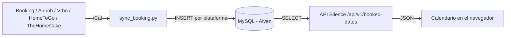

# El Rinconcito de Costa Ballena

Web de presentación y disponibilidad para un apartamento vacacional en Costa Ballena (Rota, Cádiz). Muestra galería, ubicación, reseñas y un **calendario de disponibilidad sincronizado automáticamente** con varias plataformas de reserva.

> Proyecto real desarrollado para un propietario. Esta versión de portfolio usa datos de ejemplo.

**Demo en vivo:** https://rinconcito-de-costa-ballena.onrender.com

## Funcionalidades

- Diseño responsive con galería filtrable y visor a pantalla completa.
- Calendario de disponibilidad con los días reservados, libres y pasados.
- Sincronización automática de calendarios iCal de Booking, Airbnb, Vrbo, HomeToGo y TheHomeCake.
- Sección de reseñas, mapa de ubicación (OpenStreetMap) y botones de reserva por plataforma.

## Tecnologías

| Parte | Tecnología |
|---|---|
| Frontend | HTML, CSS y JavaScript sin frameworks |
| Backend / API | [Silence](https://github.com/DEAL-US/Silence) (Python, Flask) |
| Base de datos | MySQL en Aiven |
| Sincronización | Python (`requests`, `mysql-connector-python`) |
| Despliegue | Render (Web Service) |

## Cómo funciona la sincronización de calendarios



1. Un hilo en segundo plano (lanzado desde `start.py`) descarga cada 30 minutos los iCal de cada plataforma.
2. Los rangos de fechas se guardan en la tabla `booked_dates`, con una columna `source` para saber de qué plataforma vienen.
3. Si una plataforma falla, solo se conservan sus datos anteriores: las demás se actualizan igualmente y nunca se borran fechas por un error puntual.
4. El frontend lee las fechas desde un endpoint propio, sin depender de proxies CORS de terceros.

## Estructura del proyecto

```
├── endpoints/        # Endpoints de la API (Silence)
├── sql/              # Scripts SQL de creación de tablas
├── scripts/          # Sincronización de calendarios (sync_booking.py)
├── web/              # Frontend (index.html, css, js, imágenes)
├── settings.py       # Configuración de Silence (lee variables de entorno)
├── start.py          # Arranque: sincronización en segundo plano + servidor
├── requirements.txt
└── runtime.txt       # Versión de Python para Render
```

## Ejecutarlo en local

1. Clona el repositorio e instala dependencias:
   ```bash
   pip install -r requirements.txt
   ```
2. Copia `.env.example` y rellena tus valores (o define las variables en tu terminal).
3. Crea las tablas:
   ```bash
   silence createdb
   ```
4. Arranca el servidor:
   ```bash
   silence run
   ```
5. Abre http://127.0.0.1:8080

### Variables de entorno

| Variable | Descripción |
|---|---|
| `AIVEN_HOST`, `AIVEN_PORT`, `AIVEN_USER`, `AIVEN_PASSWORD`, `AIVEN_DATABASE` | Conexión a la base de datos MySQL |
| `AIVEN_CA_CERT` | Contenido del certificado CA de Aiven |
| `SECRET_KEY` | Clave de firma de Silence |
| `ICAL_BOOKING`, `ICAL_AIRBNB`, `ICAL_VRBO`, `ICAL_HOMETOGO`, `ICAL_THEHOMECAKE` | URLs privadas de iCal de cada plataforma |

Ninguna clave ni URL privada se guarda en el repositorio.

## Retos resueltos

- **CORS y proxies caídos:** el primer enfoque descargaba el iCal desde el navegador con proxies públicos, que fallaban o bloqueaban. Se sustituyó por sincronización en servidor y lectura desde la propia API.
- **Compatibilidad de Python:** una dependencia antigua de Silence (`pypika`) no compila en Python 3.12+, así que se fija Python 3.11 en el despliegue.
- **Resolución de red:** `mysql-connector-python` daba timeouts por IPv6; se resuelve la IP manualmente antes de conectar.
- **Seguridad:** secretos fuera del código, endpoints de escritura eliminados y sincronización tolerante a fallos por plataforma.

## Autor

**Carlos Durán Gallango** · https://www.linkedin.com/in/carlos-durán-gallango-aaa6883aa/?isSelfProfile=true · charliedg.dev@gmail.com
